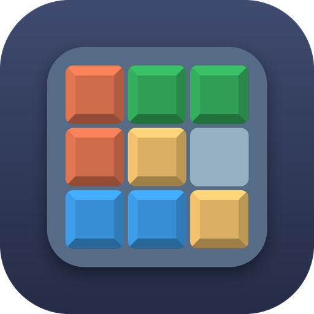

<p align="center">
  
</p>

<h1 align="center">Susun Block</h1>

Game puzzle susun blok untuk Android, dibuat dengan **Kotlin**. Seret blok ke papan 8×8, penuhi baris atau kolom untuk menghapusnya, kejar kombo, dan pecahkan skor terbaikmu!


## Developer

| | |
|---|---|
| **Developer** | Hanz Dev Official |
| **Dukung developer** | https://saweria.co/hanzreally |
| **Kontak** | hanzzcodee@gmail.com |

## Fitur

- **Blok cerdas** – algoritma menyiapkan blok yang selalu bisa ditempatkan di papan saat ini
- **4 tema warna** – tema berganti saat kamu menghapus 2 garis atau lebih sekaligus
- **Tutorial interaktif** – 3 langkah singkat untuk pemain baru
- **Skor, kombo, dan bonus "Semua Bersih!"**
- **Simpan otomatis** – progres tersimpan setiap langkah
- **Main ulang** – tombol Jeda (roda gigi) berisi Lanjutkan, Main Ulang, Pengaturan, dan Menu Utama; tutorial juga bisa diulang dari Pengaturan
- **Kontak developer** – dialog rapi dengan tombol Kirim Email, Salin Email, dan Dukung Developer
- **Efek suara & getaran** – bisa dimatikan di Pengaturan (suara dibuat lewat kode, tanpa berkas audio)
- Seluruh teks permainan dalam **Bahasa Indonesia**

## Cara Bermain

1. Seret salah satu dari tiga blok di bawah papan ke papan 8×8.
2. Baris atau kolom yang terisi penuh akan terhapus dan menambah skor.
3. Hapus garis berturut-turut dalam 3 langkah untuk mendapat **kombo**.
4. Kosongkan seluruh papan untuk bonus **+1000**.
5. Permainan selesai saat tidak ada blok yang muat.

### Rumus skor

| Aksi | Poin |
|---|---|
| Tiap sel blok yang diletakkan | +1 |
| Tiap baris/kolom terhapus | +10 × 8 |
| Hapus beberapa garis sekaligus | + garis² × 50 |
| Kombo | + garis² × 50 × kombo |
| Papan bersih | +1000 |

## Build

### Persyaratan

- JDK 17
- Android SDK (platform 34)
- Gradle 8.7+ (atau buat wrapper: `gradle wrapper --gradle-version 8.7`)

### Lokal

```bash
gradle assembleDebug     # APK debug  -> app/build/outputs/apk/debug/
gradle assembleRelease   # APK release -> app/build/outputs/apk/release/
```

Atau buka folder proyek ini di **Android Studio** lalu jalankan modul `app`.

## Rilis lewat GitHub (manual)

Build **tidak berjalan otomatis**. Workflow `.github/workflows/build-release.yml` hanya jalan saat kamu memulainya sendiri:

1. Buka repo di GitHub, lalu tab **Actions**.
2. Pilih **Build APK (Manual)** di daftar kiri.
3. Klik **Run workflow**, isi **nomor versi** (mis. `1.0.0`), lalu pilih apakah hasilnya dipublikasikan ke **GitHub Release**.
4. Klik **Run workflow** (hijau) dan tunggu sampai selesai.

APK hasil build bernama `SusunBlock-vX.Y.Z.apk`. Unduh dari halaman **Releases**, atau dari bagian **Artifacts** di halaman run jika opsi Release dimatikan.

### Tanda tangan rilis (opsional, disarankan)

Tanpa keystore, APK ditandatangani dengan debug key (tetap bisa dipasang, tapi tidak cocok untuk Play Store). Untuk memakai keystore sendiri, buat lalu simpan sebagai **Repository secrets**:

```bash
keytool -genkey -v -keystore release.jks -keyalg RSA -keysize 2048 -validity 10000 -alias susunblock
base64 -w0 release.jks   # salin hasilnya ke secret KEYSTORE_BASE64
```

| Secret | Isi |
|---|---|
| `KEYSTORE_BASE64` | isi `release.jks` dalam base64 |
| `KEYSTORE_PASSWORD` | kata sandi keystore |
| `KEY_ALIAS` | alias kunci (mis. `susunblock`) |
| `KEY_PASSWORD` | kata sandi kunci |

> Simpan keystore-mu baik-baik. Update aplikasi harus ditandatangani dengan kunci yang sama.

## Struktur Proyek

```
app/src/main/java/id/hanzdev/susunblock/
├── MainActivity.kt        # Menu utama
├── GameActivity.kt        # Layar permainan
├── SettingsActivity.kt    # Pengaturan
├── Dev.kt                 # Info developer
├── game/
│   ├── GameEngine.kt      # Papan, skor, kombo, pembuat blok cerdas
│   ├── Shapes.kt          # Daftar bentuk blok
│   ├── Themes.kt          # Tema warna
│   ├── TutorialData.kt    # Contoh tutorial
│   ├── SaveManager.kt     # Simpan/muat progres & pengaturan
│   ├── SoundManager.kt    # Efek suara
│   ├── GameConfig.kt      # Konstanta permainan
│   └── Models.kt
└── ui/
    ├── GameView.kt        # Tampilan game (Canvas, drag & drop, animasi)
    └── UiKit.kt           # Helper tampilan menu
```

## Pengembangan

### Menambah blok baru

Buka `game/Shapes.kt`, tambahkan satu baris dan perbarui `largeIds`/`smallIds`:

```kotlin
s(39, 3, 2, "110011"),   // id, lebar, tinggi, sel (1 = terisi, baris demi baris)
```

### Menambah tema baru

Buka `game/Themes.kt` dan tambahkan `GameTheme(...)` ke daftar `Themes.all`.

### Algoritma blok cerdas

1. **Simulasi papan** – menyalin papan lalu mencoba tiap blok di semua posisi
2. **Penilaian** – tiap sel kosong bernilai (1 + tetangga kosong)², blok lebih besar bernilai lebih tinggi
3. **Pemilihan** – memilih blok terbaik (acak di antara kandidat teratas), dan makin ketat saat papan terisi ≥ 60%

## Kredit & Lisensi

Susun Block adalah port Kotlin/Android dari proyek Unity **BlockPuzzle** karya **Babken Inants**. Kode asli dirilis di bawah *Non-Commercial Open License* (lihat [LICENSE](LICENSE)): penggunaan **non-komersial**, atribusi wajib dipertahankan, dan karya turunan harus memakai lisensi yang sama.

## Kontak & Dukungan

- Kontak: hanzzcodee@gmail.com
- Dukung developer: https://saweria.co/hanzreally
